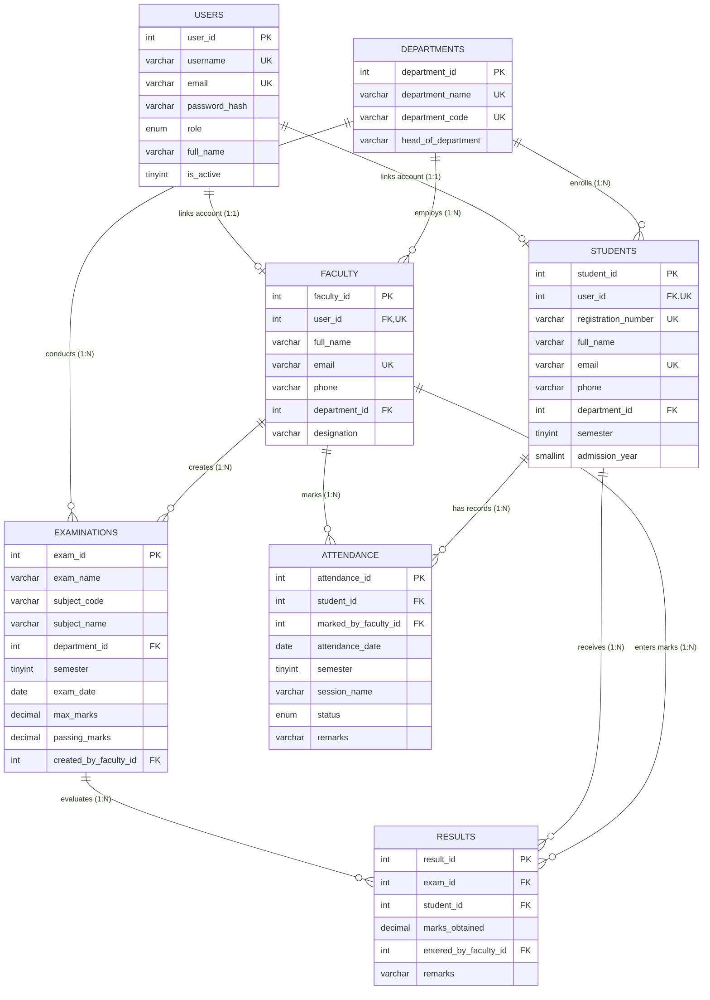

# University Management System (UniPortal ERP)

A full-stack University Management System built from scratch with **Node.js**, **Express.js**, **MySQL 8+**, **HTML5/CSS3**, **Bootstrap 5**, **Chart.js**, and **Vanilla JavaScript** for a college DBMS semester project.

---

## Features & Modules

1. **Authentication & Role Management**
   - Secure session-based login/logout (`express-session`) with `bcrypt` password hashing.
   - Three role-isolated portals: **Admin**, **Faculty**, and **Student**.
   - Backend route guards protecting both HTML pages and REST API endpoints.

2. **Student Management (Admin)**
   - Add, view, edit, delete, and search students by name or registration number.
   - Filter by department and semester, view individual student profiles with attendance & exam history.
   - Enforces unique registration numbers and email addresses across `students` and `users`.

3. **Faculty & Department Management (Admin)**
   - Add, view, edit, and delete faculty members.
   - Create, edit, and safely delete departments; assign Heads of Department and reassign faculty across departments.

4. **Attendance Management (Faculty & Admin)**
   - Faculty view students in their assigned department, pick date/semester/session, mark Present or Absent, and update existing records.
   - Duplicate prevention on `(student_id, attendance_date, session_name)`.
   - Admin & Faculty attendance percentage calculation:
     `Attendance Percentage = (Total Present Classes / Total Conducted Classes) × 100`
   - Filterable attendance records, summary KPIs, CSV export, and print-ready reports.

5. **Examination & Results Management (Faculty, Admin & Student)**
   - Faculty create subject examinations with configurable maximum and passing marks (default 40% threshold), enter and update student marks.
   - Automatic calculation of percentages and `PASS` / `FAIL` status via SQL views and triggers.
   - Admin & Faculty view examination result reports, consolidated student standings, and CSV/print reports.
   - Students view their own subject-wise marks, total marks, overall percentage, and pass/fail status.

6. **DBMS Concepts Demonstration (`dbms-concepts.html`)**
   - Interactive live explorer demonstrating 11 core DBMS topics against `university_management_db`:
     1. Primary Key and Foreign Key
     2. `INNER JOIN`
     3. `LEFT JOIN`
     4. `GROUP BY` and `HAVING`
     5. Aggregate Functions (`COUNT`, `SUM`, `AVG`, `MIN`, `MAX`)
     6. Database Views (`vw_student_attendance_summary`, etc.)
     7. Stored Procedures (`sp_get_department_report`, etc.)
     8. Triggers (`BEFORE INSERT` / `BEFORE UPDATE` integrity & normalization)
     9. Transactions (live `START TRANSACTION` / `UPDATE` / `ROLLBACK` atomicity test)
     10. Indexing (`INFORMATION_SCHEMA.STATISTICS`)
     11. Normalization (1NF, 2NF, 3NF decomposition)

---

## Entity-Relationship (ER) Diagram



---

## Project Structure

```text
university-management-system/
├── frontend/
│   ├── index.html
│   ├── login.html
│   ├── admin-dashboard.html
│   ├── faculty-dashboard.html
│   ├── student-dashboard.html
│   ├── students.html
│   ├── faculty.html
│   ├── departments.html
│   ├── attendance.html
│   ├── examinations.html
│   ├── results.html
│   ├── dbms-concepts.html
│   ├── css/style.css
│   ├── js/
│   └── assets/university-logo.svg
├── backend/
│   ├── server.js
│   ├── config/database.js
│   ├── routes/
│   ├── controllers/
│   ├── middleware/
│   ├── services/
│   ├── tests/
│   └── package.json
├── database/
│   ├── schema.sql
│   ├── sample_data.sql
│   ├── views.sql
│   ├── procedures.sql
│   ├── triggers.sql
│   ├── indexes.sql
│   └── demo_queries.sql
├── .env.example
├── .gitignore
└── README.md
```

---

## Step-by-Step Local Setup Guide for Windows

This guide explains how to set up and run the University Management System on any Windows laptop using your own local MySQL Server and MySQL Workbench, completely independent of other environments.

### 1. Install Node.js
- Download and install **Node.js LTS (v20+ or v24+)** from [nodejs.org](https://nodejs.org/).
- Verify installation in PowerShell:
  ```powershell
  node -v
  npm.cmd -v
  ```

### 2. Install MySQL Server
- Download **MySQL Community Server 8.0+** from [dev.mysql.com/downloads/mysql](https://dev.mysql.com/downloads/mysql/).
- During installation:
  - Choose a strong `root` account password and note it down.
  - Keep the default port `3306`.
  - Install MySQL as a Windows Service (default service name: `MySQL80`) and ensure it starts automatically.

### 3. Open MySQL Workbench
- Launch **MySQL Workbench** from your Windows Start Menu.
- In the home screen, click on the connection tile **Local instance MySQL80** (connecting to `localhost:3306` with user `root`).
- Enter your local MySQL `root` password when prompted.

### 4. Create `university_management_db`
- In MySQL Workbench, open a new SQL query tab (**File -> New Query Tab** or `Ctrl + T`).
- Type and execute:
  ```sql
  CREATE DATABASE IF NOT EXISTS university_management_db
    CHARACTER SET utf8mb4
    COLLATE utf8mb4_unicode_ci;
  ```
- Click the lightning bolt icon (⚡) or press `Ctrl + Shift + Enter` to execute.

### 5. Import the SQL Files in the Exact Order
You can import the database scripts either via **Automated PowerShell Script** or via **MySQL Workbench**:

#### Option A: Automated PowerShell Script (Recommended)
Open PowerShell in the project root folder and execute:
```powershell
.\setup_database.ps1 -Password "YOUR_LOCAL_MYSQL_PASSWORD"
```
*(This automatically runs all 6 SQL files in the exact required order and generates your `.env` configuration file).*

#### Option B: Manual Import via MySQL Workbench
Open and execute each file from the `database/` folder in this exact sequence:
1. `database/schema.sql` — Creates all 7 core tables, primary keys, and foreign keys.
2. `database/sample_data.sql` — Populates departments, accounts, faculty, students, attendance, exams, and results.
3. `database/views.sql` — Creates student profiles, attendance summaries, results, and department views.
4. `database/procedures.sql` — Creates stored procedures for reports and transcripts.
5. `database/triggers.sql` — Creates data normalization and validation triggers.
6. `database/indexes.sql` — Creates composite and foreign key performance indexes.

*(Note: `demo_queries.sql` contains standalone queries for demonstrating 11 DBMS concepts in lab presentations).*

### 6. Configure the `.env` File with Your Local Credentials
Create or update `.env` in the project root (and `backend/.env`):
```env
# Server Configuration
PORT=3000
NODE_ENV=development
SESSION_SECRET=your_random_secret_session_key

# Local MySQL Database Configuration
DB_HOST=localhost
DB_PORT=3306
DB_USER=root
DB_PASSWORD=YOUR_LOCAL_MYSQL_PASSWORD
DB_NAME=university_management_db
DB_CONNECTION_LIMIT=10
```
> **Security Note:** The `.env` file is excluded in `.gitignore` so your personal database credentials are never pushed to Git.

### 7. Open the Project Terminal
- Open PowerShell or Command Prompt.
- Navigate to the project backend directory:
  ```powershell
  cd C:\DBMS_project\DBMS_University_Management_System\backend
  ```

### 8. Run `npm install`
Install the Node.js backend dependencies:
```powershell
npm.cmd install
```

### 9. Run `npm start`
Start the application server:
```powershell
npm.cmd start
```
The terminal will display:
```text
University Management System running at http://localhost:3000
[MySQL] Connected successfully to local MySQL Server v8.0.46
[MySQL] Active database: university_management_db (12 tables verified)
```

### 10. Open `http://localhost:3000`
Open your web browser and navigate to:
**http://localhost:3000**

---

## How to Inspect Tables & Execute SQL Queries in MySQL Workbench

1. **View Tables & Views**:
   - In MySQL Workbench's left sidebar under the **Navigator** pane, expand **Schemas**.
   - Right-click and choose **Refresh All**.
   - Expand `university_management_db` to inspect:
     - **Tables**: `users`, `departments`, `faculty`, `students`, `attendance`, `examinations`, `results`.
     - **Views**: `vw_student_profiles`, `vw_student_attendance_summary`, `vw_student_results_detail`, `vw_department_summary`, `vw_faculty_directory`.
     - **Stored Procedures**: `sp_get_department_report`, `sp_get_student_transcript`, etc.
     - **Triggers**: under individual tables (e.g., `results`, `attendance`).

2. **Inspect Table Data**:
   - Hover over any table name (e.g. `students`) and click the small table grid icon on the right, or run:
     ```sql
     USE university_management_db;
     SELECT * FROM students;
     SELECT * FROM vw_student_results_detail;
     ```
   - Results will appear in the **Result Grid** below.

3. **Verify Foreign Keys & Referential Integrity**:
   - Right-click any table (e.g. `attendance`) and click **Alter Table...** to see Column names, Primary Keys (PK), Foreign Keys (FK), and Foreign Key Relationships in the bottom tabs.

---

## Demo Login Credentials

| Role    | Email / Identifier       | Username       | Password      | Scope |
|---------|--------------------------|----------------|---------------|-------|
| Admin   | `admin@university.edu`   | `admin`        | `Admin@123`   | Full administrative access across all modules |
| Faculty | `faculty1@university.edu`| `faculty.cse`  | `Faculty@123` | Department: Computer Science & Engineering (CSE) |
| Student | `student1@university.edu`| `reg2024001`   | `Student@123` | Aarav Sharma (CSE, Semester 4) |

---

## Database Connectivity Tests & Verification

From the `backend` directory, you can run three built-in test commands:

1. **Test MySQL Connectivity & Core Tables**:
   ```powershell
   npm.cmd run test:db
   ```
   *Runs `SELECT VERSION()`, `SELECT DATABASE()`, and `SHOW TABLES`, validating connectivity and reporting specific troubleshooting steps if connection fails.*

2. **Run Live System End-to-End Verification**:
   ```powershell
   npm.cmd run verify:live
   ```
   *Runs an end-to-end integration test against your live local MySQL database, validating authentication for all roles, CRUD operations, dashboards, attendance, exams, views, triggers, and all 11 DBMS concepts.*

3. **Run Unit Tests (Mocked)**:
   ```powershell
   npm.cmd test
   ```

